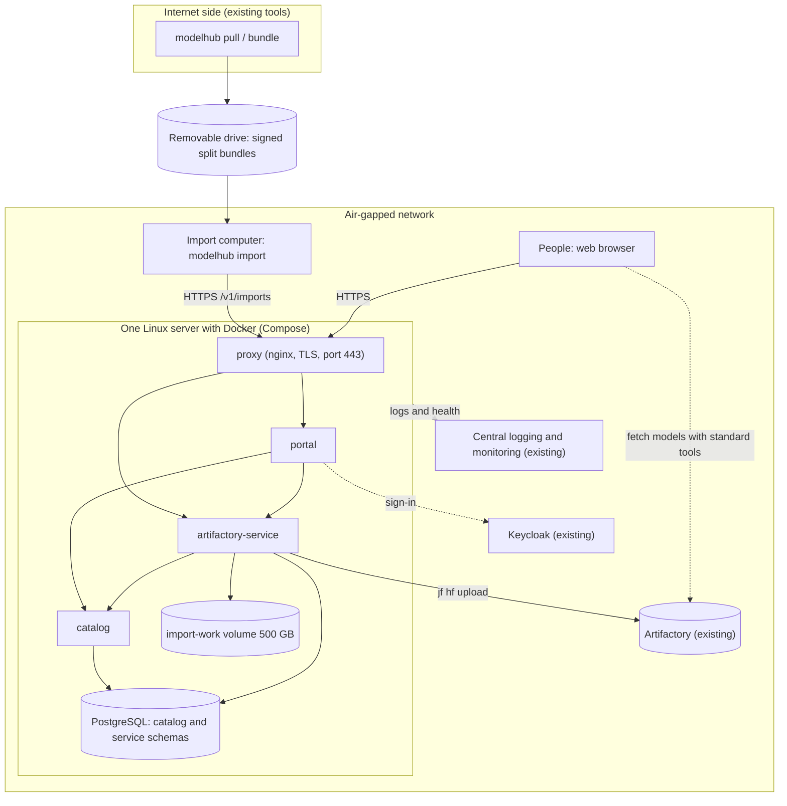
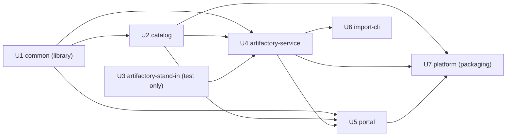
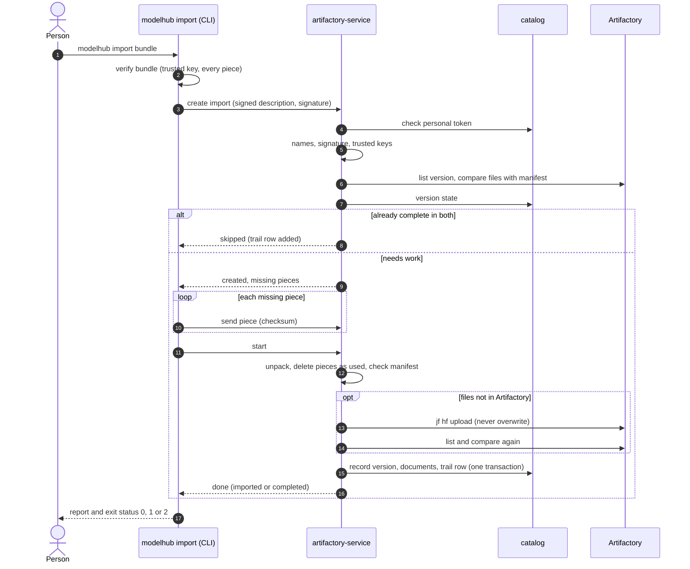
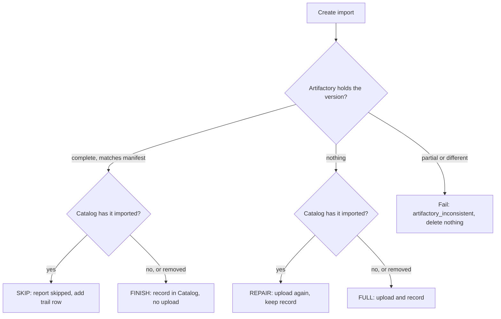
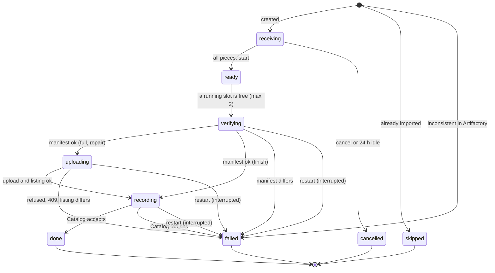
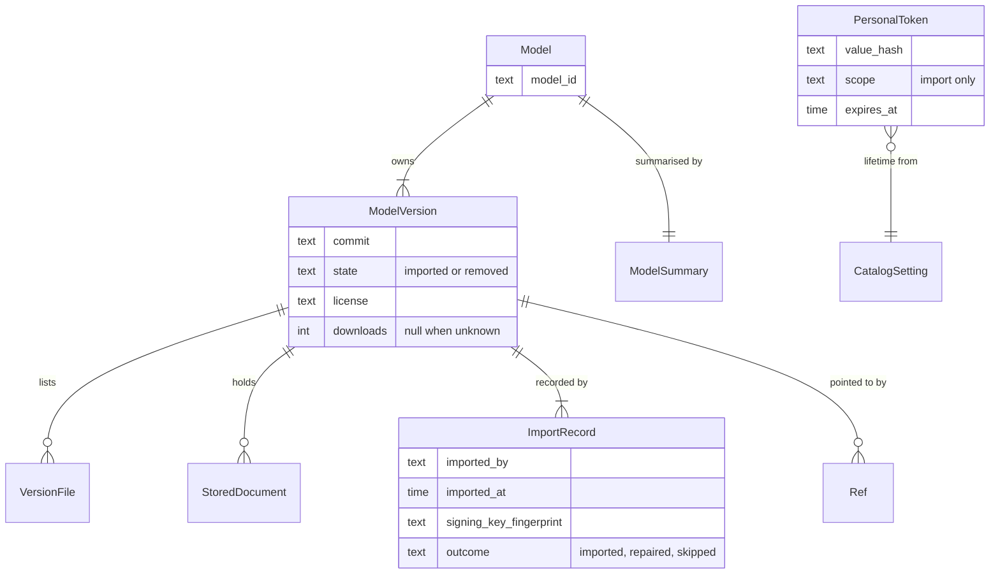
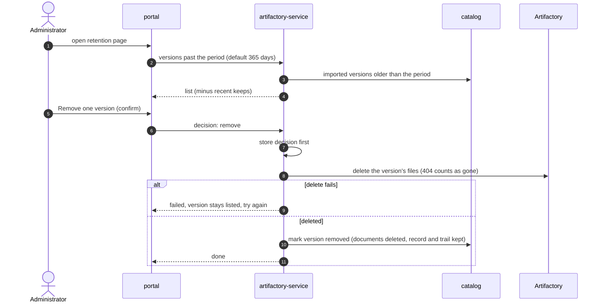
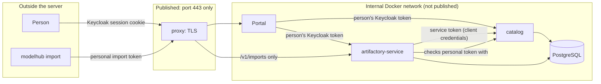
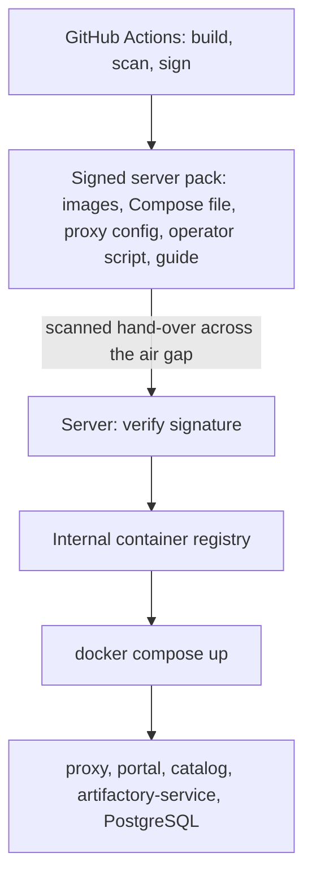
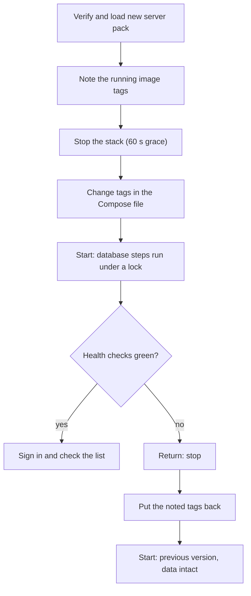

# Enterprise ModelHub: Architecture Overview

This page summarises the design in `aidlc/spaces/default/intents/261011-enterprise-modelhub/`. It is a design only; no code has been written for it. Requirement IDs (FR, NFR), rule IDs (BR) and contract IDs (C1 to C8) point to the detailed documents. The work was done in the AI-DLC stages: intent, feasibility, scope, requirements, domain design, units, contracts, delivery plan, then for each of seven units the functional design, quality targets, quality design and infrastructure design.

## 1. What this is

Today, a command-line program downloads public Hugging Face models online and packs them into signed bundles. On the air-gapped side it verifies and unpacks them into a folder, which a prototype web app can browse. The enterprise version does three more things:

1. The CLI imports a verified bundle into the organisation's **existing Artifactory** (Hugging Face repository, Machine Learning layout), through a server-side import service.
2. Everything *about* each model (card fields, files, README and pictures, who imported it and when, retention decisions) is stored in a **PostgreSQL database**.
3. The web app becomes a **portal** with Keycloak sign-in, reading only from the database, and hosted with the other parts as **Docker containers**.

## 2. The whole system at a glance

Text fallback: people and import computers reach only the proxy. The proxy sends web pages to the portal and import calls to `artifactory-service`. The portal calls the Catalog and `artifactory-service`; `artifactory-service` calls the Catalog and uploads to the existing Artifactory; both services use PostgreSQL; sign-in is with the existing Keycloak. Model files are fetched straight from Artifactory with standard tools and never pass through these containers.

## 3. Where each kind of information lives

| Information | Held in | Source of truth for | Why |
|---|---|---|---|
| Model files (weights, tokenizers, ...) | Artifactory | the files | Artifactory is the organisation's artifact store; the portal never serves files |
| Model information: card fields, counts, file list, refs, licence | PostgreSQL (Catalog schema) | the information | searchable and filterable in under a second |
| README, pictures, saved Hugging Face responses, manifests, bundle signatures | PostgreSQL, separate documents table | the documents | stored in the same transaction as the record |
| Import trail (who, when, which computer, which signing key) | PostgreSQL, append-only table | the trail | accountability |
| Retention decisions, trusted signing keys, import jobs, locks | PostgreSQL (artifactory-service schema) | those records | not model information (ADR-003, ADR-006) |
| Personal tokens (hash only) | PostgreSQL (Catalog schema) | CLI sign-in | shown once, stored as a keyed hash |

## 4. The seven units (what gets built)

Arrows mean "is needed by". Each unit went through functional design, quality targets (NFR), quality design and infrastructure design.

| Unit | What it is | Delivered as |
|---|---|---|
| U1 common | Token check, secrets, JSON logging, health checks; shared by the three services | library inside the service images |
| U2 catalog | The only reader and writer of model information, trail and tokens | container |
| U3 artifactory-stand-in | An imitation of Artifactory so everything can be built and tested without one | test code only, never delivered |
| U4 artifactory-service | Import (re-check, upload, record), trusted keys, retention, the only caller of Artifactory | container (with the JFrog CLI) |
| U5 portal | The web app (from `web/`), now with sign-in, search, import trail, token page, admin screens | container |
| U6 import-cli | `modelhub import`, `login`, `logout` added to the existing program | the existing single-file program and offline packs |
| U7 platform | Compose file, proxy, secrets, volumes, server pack, upgrade and return steps | files and scripts |

## 5. How an import works

The service decides one of four plans from what Artifactory and the Catalog each hold (rule BR1.3 of `artifactory-service`):

An import can be stopped at any moment and run again: every request is safe to repeat, pieces already stored are not sent again, and at start-up any import that was running is marked failed as "interrupted" so a rerun is decided afresh.

## 6. Data model (Catalog)

The models list reads only `ModelSummary` (one row per model with the latest imported version), never the documents, which is how it meets the target of under 1 second for 95% of requests at 1,000 models (NFR2). A store writes the version, files, documents, summary row and trail row in one transaction.

## 7. Retention

Nothing is ever removed without a decision for that version, and there is no bulk action. A removed version can be imported again; the Catalog then reinstates it with a new trail row.

## 8. Security: who may reach what

| Caller | Credential | May do |
|---|---|---|
| Person in the portal | Keycloak sign-in; the portal's server holds the tokens, the browser only a session cookie | browse, search, fetch instructions, make personal tokens |
| Administrator | Keycloak role `modelhub-admin` | retention decisions, token lifetime, trusted keys |
| CLI | Personal token made in the portal; import only; 90 days by default; shown once; stored as a keyed hash | import |
| `artifactory-service` | Keycloak client credentials (`modelhub-artifactory-service`) | write to the Catalog, remove marking, list versions |

Other protections: secrets only as files under `/run/secrets`; containers non-root, read-only, capabilities dropped; the Artifactory credential lives only in `artifactory-service`; each service's database user reaches only its own schema; the Catalog's user cannot update or delete trail rows; images are scanned and pinned by digest.

## 9. How the images get to the server

No container downloads anything while running. The single-file program and offline packs are released as today.

## 10. Upgrade and return

The previous images stay on the server and in the registry. Database changes only add; data is never removed in the same release that stops using it.

## 11. Targets that shaped the design

| Area | Target |
|---|---|
| Models list | under 1 second for 95% of requests at 1,000 models and 10,000 versions, with 20 people at once |
| Findability | a model appears the moment its store commits |
| Large imports | bundles up to 200 GB; 100 GB in under 4 hours on a 1 Gbit/s link (to be measured on a real Artifactory); memory at or below 8 GB at peak |
| Restart | an import stopped at any moment and rerun gives a correct, complete result |
| Availability | business hours; back within 4 business hours of a failure noticed |
| Offline | no part connects to the internet while running |
| Stack | Python 3.12, FastAPI, psycopg 3 with plain SQL, PostgreSQL 16, Authlib (portal sign-in), PyJWT (token check), httpx (CLI), Debian-based images |
| Sizing | server minimum about 4 cores and 16 GB; database volume 100 GB; import working volume 500 GB |

## 12. What is not decided or not covered

- **Artifactory's Machine Learning layout:** JFrog's pages do not say where files are stored or how they are listed and deleted. The gateway discovers paths by listing; the stand-in's checklist lists every behaviour to confirm on a real Artifactory (open item X1). Its version must be 7.77.1 or later (X2).
- **Keycloak:** the clients `modelhub` and `modelhub-artifactory-service` and the realm role `modelhub-admin` must be created by its administrators (X3). "Signed-in people keep working if Keycloak is down" holds only while their access token is valid.
- **Old-folder import (FR8):** designed as a reserved option, not built; the old model store has no signature to check.
- **Backup:** left to a later phase; data is on named volumes so a stop-and-copy backup works.
- **Walking skeleton:** with no code, it is a paper trace spread over the units; a running end-to-end slice comes when building starts.
- **Defaults to confirm:** personal-token lifetime 90 days and 20 active tokens per person; retention 365 days; 16 MiB per stored document; two imports at once.
- **Unit order for building:** the engine follows the dependency graph (stand-in and common first, then catalog, artifactory-service, portal, import-cli, platform), which differs slightly from the Bolt plan's order; the dependencies are the same.

## 13. Where to find the detail

| Topic | Document |
|---|---|
| Why and what | `ideation/intent-capture/`, `ideation/scope-definition/` |
| Requirements and acceptance criteria | `inception/requirements-analysis/requirements.md` |
| Components and decisions (ADR-001 to ADR-010) | `inception/domain-design/` |
| Units and dependencies | `inception/units-generation/` |
| Contracts C1 to C8 (APIs, errors, retries) | `inception/contract-design/contract-summary.md` |
| Delivery plan and outside dependencies | `inception/delivery-planning/` |
| Per-unit entities, rules (BR), specs | `construction/<unit>/functional-design/` |
| Per-unit quality targets and designs | `construction/<unit>/nfr-requirements/`, `nfr-design/` |
| Hosting, Compose, install and upgrade steps | `construction/platform/infrastructure-design/` |
