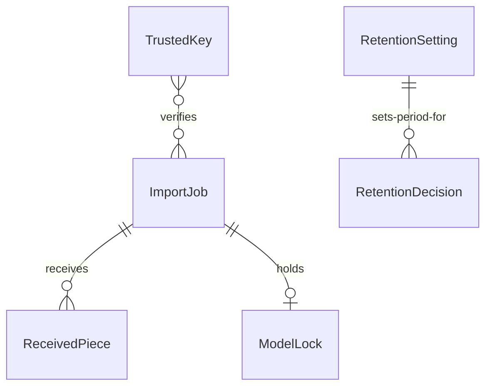

# Functional Specification: artifactory-service

This file is the source of truth for the ordered steps and the states of an import and of a retention decision. Entity shapes are in `entities.md` and the decision rules (BR1.1 to BR1.21) in `rules.md`; the diagram and table at the end are derived from them. The interfaces are contracts C1 (import), C2 (Catalog), C4 (retention and keys) and C5 (what we rely on in Artifactory).

## Workflow W1: Create An Import (POST /imports)

1. Check the personal token with the Catalog; learn who the owner is. [BR1.1]
2. Check the names against Artifactory's rules; parse the signed description; check the signature against the trusted keys. Any fault is 422 and nothing is stored. [BR1.2]
3. Check there is room on disk for the bundle plus 10 percent; else 507 (retryable). [BR1.20]
4. Take the per-model lock. If one unfinished import of the same commit by the same person exists, return it; if any other holds the lock, 409 model_locked. [BR1.9]
5. List the version in Artifactory and compare with the manifest; read the version's state from the Catalog. [BR1.3, BR1.19]
6. Decide the plan:
   - complete in Artifactory and imported in the Catalog: skip. The Catalog adds a trail row (skipped), the job ends as skipped, the lock is released and no piece is needed (200). [BR1.3]
   - complete in Artifactory, not in the Catalog (or removed there): finish. [BR1.3]
   - nothing in Artifactory, imported in the Catalog: repair. [BR1.3]
   - nothing in either: full. [BR1.3]
   - partial or different in Artifactory: fail with 409 artifactory_inconsistent, nothing deleted, lock released. [BR1.3]
7. For finish, repair and full, create the job in state receiving and answer 201 with the missing pieces. [BR1.4]

## Workflow W2: Send Pieces And Start

1. Each piece: index in range; written to a temporary file with its checksum computed; compared with the header and the description; moved into place; a repeat is accepted. [BR1.4]
2. Start: every piece must be present, else 409 pieces_missing; a repeat returns the state. [BR1.5]
3. If the running limit is reached, 503 service_busy and the job waits in receiving; otherwise it goes to verifying. [BR1.10]

## Workflow W3: Run The Import

1. **Verifying.** Join and unpack the pieces in order, deleting each as used; check every file against the signed manifest. A difference ends the job as failed manifest_mismatch. [BR1.6]
2. **Uploading** (plans full and repair only). Run `jf hf upload`; retry network errors at 1, 2, 4, 8 and 16 seconds plus a little random wait; 409 from Artifactory fails with artifactory_conflict; list and compare afterwards. Plan finish skips this step. [BR1.7, BR1.19]
3. **Recording.** Send the record (or, for repair, an import-only record) to the Catalog. [BR1.8]
4. **Done.** Set the outcome (imported for full, completed for finish and repair), remove working files, release the lock. [BR1.8, BR1.9]
5. Progress is readable throughout; messages are made from fixed texts. [BR1.12]

## Workflow W4: Cancel, Idle And Restart

1. DELETE cancels an unfinished import, removes its files and releases the lock. [BR1.11]
2. An import idle for 24 hours is cancelled the same way. [BR1.9]
3. At start-up, any import that was verifying, uploading or recording is failed as interrupted, retryable, with its working files removed; the CLI's rerun is decided afresh by W1 step 6. [BR1.11]

## Workflow W5: Trusted Keys

1. List (administrators): fingerprint, label, who added, when. [BR1.13]
2. Add: public key, label and the fingerprint the administrator has confirmed; the service computes the fingerprint and refuses a mismatch. [BR1.13]
3. Revoke: later bundles signed by that key are refused; finished imports are not affected. [BR1.13]

## Workflow W6: Retention

1. The setting is read or changed by an administrator, 1 to 3650 days. [BR1.14]
2. The list shows imported versions older than the period, counted from the later of import and last keep. [BR1.15]
3. The administrator decides one version at a time: keep (age restarts) or remove. [BR1.16]
4. Remove: delete from Artifactory (404 counts as gone); if that fails the version stays listed with the failure shown; if it works, ask the Catalog to mark it removed; if that fails, record files_deleted_not_marked and repeat only that step next time. [BR1.17]
5. Each decision is stored with who and when and listed for the portal's trail view. [BR1.18]

## State Machine: ImportJob

| From | Event | To | Rule |
|------|-------|----|------|
| (none) | create, plan skip | skipped | BR1.3 |
| (none) | create, plan finish/repair/full | receiving | BR1.3 |
| (none) | create, inconsistent in Artifactory | failed | BR1.3 |
| receiving | all pieces present and start | ready | BR1.5 |
| ready | running slot free | verifying | BR1.10 |
| verifying | manifest ok, plan full/repair | uploading | BR1.6 |
| verifying | manifest ok, plan finish | recording | BR1.6 |
| verifying | manifest differs | failed | BR1.6 |
| uploading | upload and listing ok | recording | BR1.7 |
| uploading | refused or 409 or listing differs | failed | BR1.7 |
| recording | Catalog accepts | done | BR1.8 |
| recording | Catalog refuses | failed | BR1.8 |
| receiving, ready | cancel or idle 24 h | cancelled | BR1.9, BR1.11 |
| verifying, uploading, recording | restart | failed (interrupted) | BR1.11 |

## State Machine: RetentionDecision (remove)

| From | Event | To | Rule |
|------|-------|----|------|
| (none) | remove decided | failed (pending) | BR1.17 |
| failed | Artifactory delete and Catalog mark both succeed | done | BR1.17 |
| failed | Artifactory delete succeeds, Catalog mark fails | files_deleted_not_marked | BR1.17 |
| files_deleted_not_marked | repeat remove, Catalog mark succeeds | done | BR1.17 |
| failed | repeat remove | done or failed | BR1.17 |

## Edge Cases Settled

- **Same model, different commit at once.** The lock is per model, so the second is refused with model_locked. [BR1.9]
- **Finish needs the pieces.** The documents for the Catalog are inside the bundle, so the CLI still sends every piece when only the database part is missing; only the Artifactory upload is skipped. [BR1.3]
- **Two administrators deciding the same version.** Each decision is stored; a second remove after the first finished is 409 (version no longer imported). [BR1.16]
- **A removed version imported again.** The plan is decided as if the Catalog had none, and the Catalog reinstates it. [BR1.3]
- **Piece checksum fine but unpack fails.** The job fails with manifest_mismatch and cleans up. [BR1.6]
- **Artifactory unreachable at create.** The create fails with a retryable error; no lock is kept. [BR1.19, BR1.9]
- **Secret rotated.** Takes effect on restart (common rule). 

## Derived: Entity Relationship Diagram

Text fallback: an ImportJob receives pieces and holds at most one ModelLock; TrustedKeys verify jobs' signatures; the RetentionSetting sets the period against which RetentionDecisions are made.

## Derived: Rules Summary

21 rules in `rules.md`: access (BR1.1), create checks and plan (BR1.2, BR1.3, BR1.20), pieces and start (BR1.4, BR1.5, BR1.10), run (BR1.6 to BR1.8, BR1.12), lock and restart (BR1.9, BR1.11), keys (BR1.13), retention (BR1.14 to BR1.18), the gateway (BR1.19) and upgrades (BR1.21).
