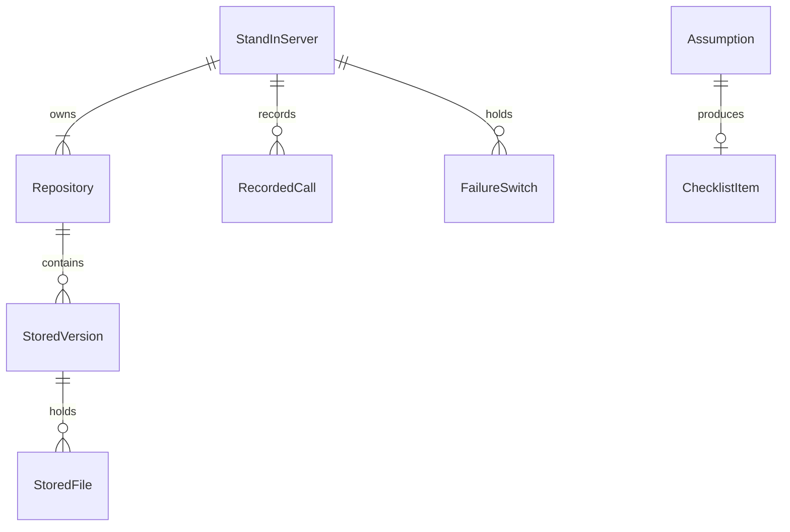

# Functional Specification: artifactory-stand-in

The stand-in imitates Artifactory's Hugging Face repository for tests (FR7). This file is the source of truth for the ordered steps and the version's states. The entity shapes are in `entities.md` and the decision rules (BR1.1 to BR1.16) in `rules.md`; the diagram and table at the end are derived from them. It is never delivered (BR1.14).

## Calls It Answers (and Why)

These are the only calls (BR1.16). They are those made by the installed `huggingface_hub` for `upload_folder` and `snapshot_download`, plus the listing and delete the gateway needs (C5).

| Group | Call | Used by |
|-------|------|---------|
| Create | create repository (`/api/repos/create`) | `jf hf upload` |
| Upload | pre-upload check (`/api/models/<id>/preupload/<rev>`) | `jf hf upload` |
| Upload | large-file batch (`<repo>.git/info/lfs/objects/batch`) and the object upload it points to | `jf hf upload` |
| Upload | commit (`/api/models/<id>/commit/<rev>`) | `jf hf upload` |
| Read | tree and paths-info (`/api/models/<id>/tree/<rev>`, `paths-info`) | `snapshot_download`, the gateway |
| Read | fetch a file (`/<id>/resolve/<rev>/<path>`) | `snapshot_download` |
| Read | storage-style listing of files and checksums (Artifactory's own API, in the active layout) | the gateway |
| Delete | delete a version | retention in `artifactory-service` |
| Test only | read the recorded calls; set, clear and list failure switches; mark a path keep; read the assumption register and checklist | the tests (a separate control address, not part of the imitated surface) |

## Workflow W1: Start And Stop

1. The test starts the stand-in with a token, a layout (flat or nested), the keep limit, and whether writing and overwriting are allowed. [BR1.14, BR1.12, BR1.9]
2. It creates an empty temporary folder, picks a free port and binds to 127.0.0.1 only; if the bind address is not local, it refuses to start. [BR1.14]
3. It answers calls until the test stops it. Stopping removes the temporary folder and all state. [BR1.14]

## Workflow W2: Upload A Version (as `jf hf upload` does it)

1. Each call is first checked for a failure switch that applies; if one fires, its effect is the answer and nothing below runs. [BR1.10]
2. The bearer token is checked; wrong or missing gives 401, no write permission on a changing call gives 403. [BR1.1]
3. Create repository: the repository key is created if absent; names are checked. [BR1.2]
4. Pre-upload: for each file path, check the path (no escape) and answer whether it goes as a regular file or a large file. [BR1.15, BR1.2]
5. Large-file batch: for each large file, answer with where to send the object. The object is then received; for a kept file its SHA-256 is computed and compared with the declared one; a virtual file's content is discarded as it arrives. [BR1.6, BR1.9]
6. Commit: the stand-in gathers the files received for the version, checks names and paths again, and then: if a complete version with the same name and revision exists and overwrite is not allowed, answer 409. [BR1.3]
7. Otherwise it computes the commit hash, moves the version from partial to complete in one step, and returns the hash. [BR1.4, BR1.5]
8. At any point before step 7, if the connection is lost or a switch fires, the version stays partial and invisible. [BR1.5, BR1.10]

## Workflow W3: Read A Version

1. Failure switches, then the token are checked as in W2 steps 1 and 2. [BR1.10, BR1.1]
2. A tree, paths-info or storage listing for a complete version returns every file's path, size and checksum; the storage listing uses the active layout. A partial or absent version gives 404. [BR1.7, BR1.12, BR1.5]
3. A fetch of a kept file returns its content; a fetch of a virtual file gives 501 with 'content not kept'. [BR1.9]

## Workflow W4: Delete A Version

1. Switches and token as before; the call needs write permission. [BR1.10, BR1.1]
2. If the version exists in any state, remove it with its files and answer 204; if not, answer 404. [BR1.8]

## Workflow W5: Misbehave On Request

1. The test sets a failure switch: its kind, which calls it matches, after how many matching calls it fires, and how many times, or sticky. [BR1.10]
2. The next matching calls are counted. Once the count passes the stated number, the switch's effect is applied to the call. A cut transfer closes the connection after half the body; a half-version stores half the commit's files and answers 500. [BR1.10, BR1.5]
3. The switch is removed after its times, unless sticky. The test can list and clear switches at any moment. [BR1.10]

## Workflow W6: Read What Happened

1. The test reads the recorded calls: sequence, method, path, status, time, and the switch that fired; never the token or any content. [BR1.11]
2. The test reads the assumption register and the checklist, produced from the register's entries needing confirmation. [BR1.13]

## State Machine: StoredVersion

| From | Event | To | Rule |
|------|-------|----|------|
| absent | first file object received | partial | BR1.5 |
| partial | commit succeeds | complete | BR1.4, BR1.5 |
| partial | commit fails or is cut | partial | BR1.5, BR1.10 |
| partial | delete | absent | BR1.8 |
| complete | commit of the same version, overwrite not allowed | complete (unchanged) | BR1.3 |
| complete | commit of the same version, overwrite allowed | complete (replaced) | BR1.3 |
| complete | delete | absent | BR1.8 |
| absent | delete | absent (answered 404) | BR1.8 |

## Edge Cases Settled

- **Empty version (no files).** A commit with no files is allowed and gives a complete version with an empty file list; recorded as an invented assumption.
- **Two spellings of one path (case).** Paths are case-sensitive and compared exactly; recorded as an assumption.
- **Odd names (spaces, non-ASCII).** Paths with these are accepted unless the naming rules or BR1.15 refuse them; file paths inside a model are not limited by the organisation, model and revision rules.
- **Disk full in the temporary folder.** The upload call answers 507 and the version stays partial; the stand-in itself never crashes.
- **Concurrent uploads to the same version.** Two commits for one version are applied one after the other under a lock; the second sees the first's result (BR1.3).
- **Unknown fields in a request.** Ignored and not recorded; unknown paths are BR1.16.

## Derived: Entity Relationship Diagram

Text fallback: a StandInServer owns repositories, recorded calls and failure switches; a Repository contains versions; a version holds files; an Assumption may produce one ChecklistItem.

## Derived: Rules Summary

16 rules (BR1.1 to BR1.16) in `rules.md`: sign-in (BR1.1), names and paths (BR1.2, BR1.15), the version's life (BR1.3 to BR1.5, BR1.8), checksums and listing (BR1.6, BR1.7), storage by size (BR1.9), failure switches and records (BR1.10, BR1.11), layouts and documentation (BR1.12, BR1.13), isolation and unknown calls (BR1.14, BR1.16).
