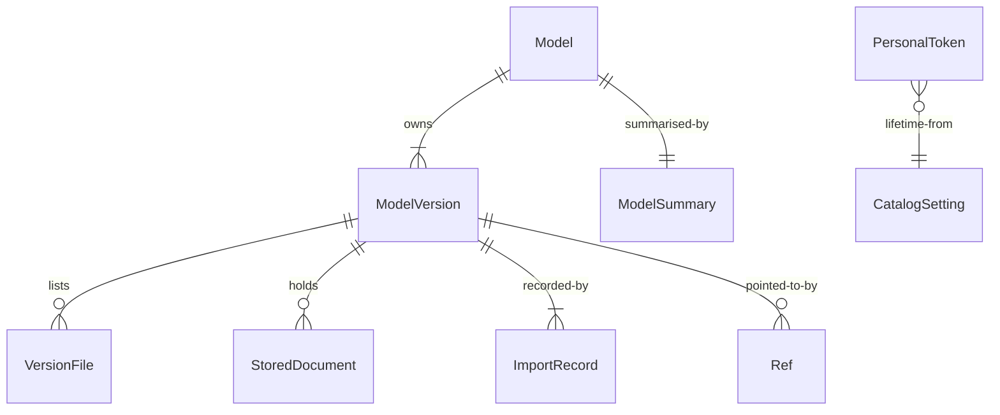

# Functional Specification: catalog

The Catalog is the only part that reads or writes model information, documents, the import trail and personal tokens. This file is the source of truth for the ordered steps and state changes. Entity shapes are in `entities.md` and the decision rules (BR1.1 to BR1.21) in `rules.md`; the diagram and table at the end are derived from them. The interface shapes are contracts C2 and C3 and are not repeated here.

## Workflow W1: Store A Version (PUT version)

1. Check the caller is the import service's service identity. [BR1.14]
2. Validate the record and documents; any fault is 422 and nothing is stored. [BR1.4, BR1.3, BR1.19]
3. Find the model by id ignoring case, or note that it is new. [BR1.10]
4. If the version exists and is removed, skip to step 5 (a reinstatement). Otherwise compute the record checksum. If a version for this model and commit exists: equal checksum gives 200 with no change; a different one gives 409 record_conflict. [BR1.2]
5. Begin one transaction. Create the model if new; write the version, files, refs, documents (with the README text as card text and search text) and one trail row; set the summary row to the imported version with the latest import time. [BR1.1, BR1.5, BR1.6, BR1.7, BR1.13]
6. Commit and answer 201. Any failure rolls back everything and answers 500 store_failed. [BR1.1]

An import that is skipped or repaired arrives as an import-only record: step 5 then writes only one trail row (outcome skipped or repaired) and changes nothing else. [BR1.13]

## Workflow W2: List And Search Models (GET /models)

1. Check the caller is signed in. [BR1.14]
2. Read the filters, sort and paging; an unknown value is 422 invalid_query. [BR1.8]
3. If q is given, split it into words and match card text (whole words, English word forms) and model ids and tags (parts of words). [BR1.9]
4. Read only summary rows; return the page, the total and the counts per filter value. [BR1.8]

## Workflow W3: Read One Model, A Version, A Document, The Trail

1. A model answer holds its versions (with state) and its branches and tags. [BR1.10]
2. A version answer holds the card fields, counts, files and the list of its documents, but not their content; empty values are null. [BR1.3]
3. A document is served as data under the safe headers; a removed version's document is 410. [BR1.11, BR1.12]
4. The trail is returned newest first, filtered by model and person. [BR1.13]

## Workflow W4: Mark A Version Removed (POST removal)

1. Check the caller is the service identity. [BR1.14]
2. If the version is imported, in one transaction set it removed with time and decider, delete the documents' content, clear the card and search text, and update the summary row. [BR1.12, BR1.7]
3. If it is already removed or not found, answer 409. Trail rows are never changed. [BR1.12, BR1.13]

## Workflow W5: Personal Tokens

1. **Make:** a signed-in person posts a name; the Catalog makes a random value with the prefix, stores only its keyed hash, and returns the value once. [BR1.15, BR1.18]
2. **List:** a person sees their own tokens (an administrator may see all), never a value or hash. [BR1.17]
3. **Revoke:** the owner or an administrator revokes at once; repeating is harmless; anyone else gets 404. [BR1.17]
4. **Check:** the import service posts a value to introspect; the Catalog answers active with the owner's id and name, or inactive with revoked, expired or unknown. Last-use is written at most once a minute. [BR1.16]
5. **Lifetime:** an administrator can change the lifetime (1 to 365 days); existing tokens keep theirs. [BR1.18]

## Workflow W6: Versions For Retention (GET /versions)

Service identity only; returns versions by state and age, oldest first, with the minimum fields. [BR1.14, BR1.20]

## Workflow W7: Start-Up

1. Read settings and secrets (common library). [BR1.21]
2. Apply pending database steps under a lock; refuse to start if the database is newer than the code. [BR1.21]
3. Register the ready check for the database as critical. [BR1.21]

## State Machine: ModelVersion

| From | Event | To | Rule |
|------|-------|----|------|
| (none) | first valid PUT | imported | BR1.1 |
| imported | identical PUT | imported (no change) | BR1.2 |
| imported | different PUT | imported (409) | BR1.2 |
| imported | removal | removed | BR1.12 |
| removed | removal | removed (409) | BR1.12 |
| removed | valid PUT of the same model and commit | imported (reinstated, new trail row) | BR1.2 |

## State Machine: PersonalToken

| From | Event | To | Rule |
|------|-------|----|------|
| (none) | made | active | BR1.15 |
| active | expiry time passes | expired | BR1.16 |
| active | revoked | revoked | BR1.17 |
| expired | revoked | revoked | BR1.17 |
| revoked | revoked again | revoked | BR1.17 |

## Edge Cases Settled

- **Two imports of the same model and commit at once.** The unique key on (model, commit) makes one succeed; the other sees the stored version and gets 200 or 409 by checksum. [BR1.2]
- **A model whose only version is removed.** The summary row stays with state removed and the last values. [BR1.7]
- **Re-importing a removed version.** Accepted as a reinstatement: the version becomes imported again, with its documents stored again, a new trail row, and its age counted from the new import. [BR1.2]
- **A search term shorter than 3 characters.** Matches card text only (not parts of ids and tags). [BR1.9]
- **Pepper lost or changed.** Every personal token stops working; people make new ones. [BR1.15]
- **A very large README.** Limited to 16 MiB per document; larger is 422. [BR1.4]
- **Clock differences.** Times are UTC from the server; the caller's times are stored as given.

## Derived: Entity Relationship Diagram

Text fallback: a Model owns versions and one summary row; a version lists files, holds documents, has trail rows and refs; a token's lifetime comes from a setting.

## Derived: Rules Summary

21 rules in `rules.md`: storing (BR1.1 to BR1.6, BR1.19), summary and list (BR1.7 to BR1.9), identity and documents (BR1.10, BR1.11), removal and trail (BR1.12, BR1.13), who may call (BR1.14), tokens (BR1.15 to BR1.18), retention (BR1.20) and upgrades (BR1.21).
