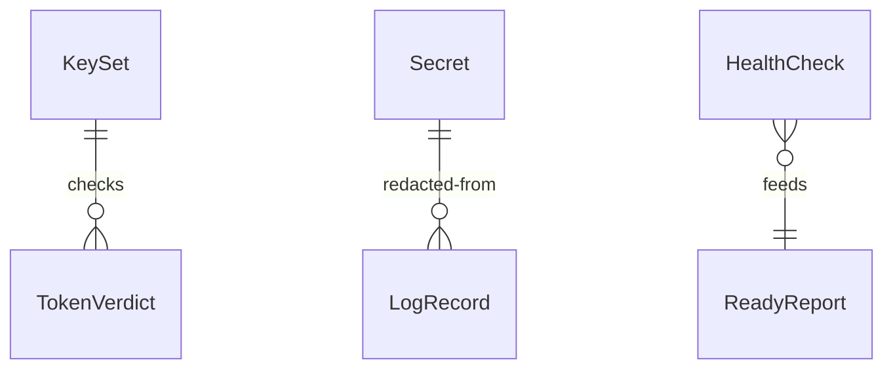

# Functional Specification: common

`common` is the shared library built into the images of `catalog`, `artifactory-service` and `portal`. This file is the source of truth for the ordered steps and the key set's states. Entity shapes are in `entities.md` and the decision rules (BR1.1 to BR1.12) in `rules.md`; the diagram and table at the end are derived from them.

## Workflow W1: Service Start-Up

1. Read the settings from the environment; collect every missing or mistyped one. [BR1.7, BR1.12]
2. Read the secrets the service named from the secrets folder; collect every missing, unreadable or empty one. [BR1.6]
3. If anything was collected in step 1 or 2, print one message with the names only and exit with a failure. Nothing is started. [BR1.6, BR1.7]
4. Fetch the Keycloak signing keys. On success the key set is loaded; on failure it stays empty and the service starts but answers 503 on the ready check until a fetch succeeds. [BR1.4, BR1.11]
5. Register the service's health checks and its extra open paths, if any. [BR1.5, BR1.11]

## Workflow W2: Check A Request's Token

1. Give the request an id: the caller's if valid, else a new one. [BR1.9]
2. If the path is /healthz, /readyz or declared open, go to the service's handler. [BR1.5]
3. Otherwise take the token from the Authorization header and check it in the order set out in BR1.1.
4. If the token is refused, answer 401 token_invalid, log the reason code only, and stop. [BR1.1, BR1.2]
5. If the token names an unknown key id and the last refresh was over 60 seconds ago, refresh the key set once and check again; a failed refresh keeps the keys already held. [BR1.4]
6. If the action needs an administrator and the person is not one, answer 403 forbidden and log it. [BR1.3]
7. Otherwise pass the person's id, name and administrator flag to the handler.

## Workflow W3: Log A Line

1. Build the line with the fixed fields and the request id. [BR1.8, BR1.9]
2. Redact fields whose names suggest a secret and any loaded secret value found in the text. [BR1.8]
3. Drop it if below the configured level, else write it to standard output as one JSON line. [BR1.8]

## Workflow W4: Live And Ready Checks

1. GET /healthz answers 200 ok with no checks. [BR1.10]
2. GET /readyz runs any registered check whose result is older than 10 seconds, each with a 2-second limit, and builds the answer. [BR1.11]
3. A critical check down, or an empty key set, gives 503; only non-critical checks down gives 200 degraded; otherwise 200 ok. [BR1.11, BR1.4]

## State Machine: KeySet

| From | Event | To | Rule |
|------|-------|----|------|
| empty | first fetch succeeds | loaded | BR1.4 |
| empty | fetch fails | empty | BR1.4 |
| loaded | refresh succeeds | loaded | BR1.4 |
| loaded | refresh fails | stale | BR1.4 |
| stale | refresh succeeds | loaded | BR1.4 |
| stale | refresh fails | stale | BR1.4 |

## Edge Cases Settled

- **Token with the right keys but a clock difference.** Up to 60 seconds either way is allowed. [BR1.1]
- **A secret file with a trailing newline.** One newline is removed; other whitespace is kept. [BR1.6]
- **Secret value appearing in an error from a dependency.** Redacted before the line is written. [BR1.8]
- **A request id with odd characters.** Replaced by a new one. [BR1.9]
- **A health check that hangs.** Counts as down after 2 seconds. [BR1.11]
- **Service-to-service tokens.** Getting a token with client credentials is not in this unit; it belongs to `artifactory-service` (recorded as an open question in the diary).

## Derived: Entity Relationship Diagram

Text fallback: the KeySet is used to produce TokenVerdicts; loaded Secret values are removed from LogRecords; HealthChecks feed the ReadyReport. Settings stand alone.

## Derived: Rules Summary

12 rules in `rules.md`: token (BR1.1 to BR1.5), start-up secrets and settings (BR1.6, BR1.7, BR1.12), logging (BR1.8, BR1.9) and health (BR1.10, BR1.11).
