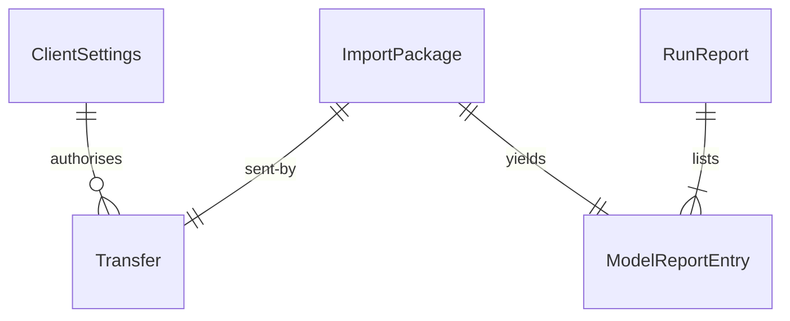

# Functional Specification: import-cli

The import command added to the existing program. This file is the source of truth for the ordered steps and the states of a transfer. Entity shapes are in `entities.md` and the decision rules (BR1.1 to BR1.14) in `rules.md`; the diagram and table at the end are derived from them. The interface is contract C1; the bundle format is C8 (unchanged).

## Commands

| Command | What it does | Rules |
|---------|--------------|-------|
| `modelhub login` | Asks for the server address and token; saves them privately | BR1.1 |
| `modelhub logout` | Deletes the saved settings | BR1.1 |
| `modelhub import <bundle...>` | Verifies each bundle, sends it, reports | BR1.3 to BR1.12, BR1.14 |
| `modelhub import --from-store <folder>` | Reserved; says it is not available yet, exit 2 | BR1.13 |
| `pull`, `bundle`, `verify`, `unpack`, `list`, `key` | Unchanged | BR1.14 |

## Workflow W1: Login

1. Ask for the server address; refuse an address that is not https unless it is localhost or 127.0.0.1. [BR1.1]
2. Ask for the token with no echo (or read it from standard input when there is no terminal). [BR1.1]
3. Save both in the person's own settings folder with owner-only permission; if the permission cannot be set, save nothing and stop. [BR1.1]
4. Print where the settings were saved, never the token. [BR1.2]

## Workflow W2: Import A List Of Bundles

1. Find the settings (environment variables first, then the file). If none, print 'run modelhub login' and exit 2. [BR1.1, BR1.3]
2. Find the bundles from the arguments; if none is found, exit 2 with a message. [BR1.4, BR1.9]
3. For each bundle in the order given, one at a time: [BR1.11]
   1. Verify it locally; a failure is a failed entry and the loop goes on. [BR1.4]
   2. Create the import on the service. [BR1.5]
      - 401: stop the whole run, exit 2. [BR1.3]
      - 426: stop the whole run, exit 2. [BR1.14]
      - 200 skipped: entry skipped. [BR1.5]
      - an error: retry or fail the entry. [BR1.6]
   3. Send each missing piece in index order, one at a time, with its checksum. [BR1.5]
   4. Start the import; if the service is busy, wait and ask again every 60 seconds up to 30 minutes. [BR1.5, BR1.7]
   5. Ask for progress every 2 seconds until done or failed; show live progress. [BR1.5, BR1.10]
   6. Turn the service's outcome into the entry. [BR1.9]
4. Print the entries and the counts; exit 0, 1 or 2. [BR1.9]

## Workflow W3: Interrupt

On Ctrl-C the program stops sending, leaves the import on the service, names the unfinished models and says that running the same command again resumes them. [BR1.8]

## State Machine: Transfer

| From | Event | To | Rule |
|------|-------|----|------|
| (start) | package given | verifying-locally | BR1.4 |
| verifying-locally | passes | creating | BR1.4, BR1.5 |
| verifying-locally | fails | finished (failed) | BR1.4 |
| creating | service says skipped | finished (skipped) | BR1.5 |
| creating | service says created | sending | BR1.5 |
| creating | error not retryable, or retries used | finished (failed) | BR1.6 |
| sending | all missing pieces sent | starting | BR1.5 |
| starting | service busy | waiting-for-place | BR1.7 |
| waiting-for-place | place free | service-working | BR1.7 |
| waiting-for-place | 30 minutes pass | finished (failed) | BR1.7 |
| starting | accepted | service-working | BR1.5 |
| service-working | service done | finished (imported or completed) | BR1.5, BR1.9 |
| service-working | service failed | finished (failed) | BR1.6, BR1.9 |
| any | interrupt | stopped (resumable) | BR1.8 |

## Edge Cases Settled

- **A list where one bundle is already imported.** That one is skipped and the rest are imported. [BR1.5, BR1.11]
- **Two people importing the same model.** The second gets model_locked and that entry fails at once with the model's name. [BR1.6]
- **A bundle given twice in one list.** The second finds the first's result (skipped) and is reported as skipped. [BR1.5]
- **A very large piece.** Read in blocks and sent as a stream; memory stays small. [BR1.5]
- **The program is closed during a wait for a place.** Resumes on the next run; pieces are still on the service. [BR1.7, BR1.8]
- **A token pasted with a trailing space or newline.** Trimmed on login. [BR1.1]
- **Output redirected to a file.** Plain progress lines every 10 seconds. [BR1.10]
- **Server certificate not trusted.** Treated as a network error that is not retried; the entry fails with the reason (assumption; the organisation's certificate setup is an open question).

## Derived: Entity Relationship Diagram

Text fallback: the saved settings authorise transfers; each package is sent by one transfer and yields one report entry; the run report lists the entries.

## Derived: Rules Summary

14 rules in `rules.md`: settings and secrecy (BR1.1, BR1.2), start (BR1.3), local check (BR1.4), sending and retries (BR1.5 to BR1.8), report and progress (BR1.9, BR1.10), order and platforms (BR1.11, BR1.12), the reserved option (BR1.13) and versioning (BR1.14).
