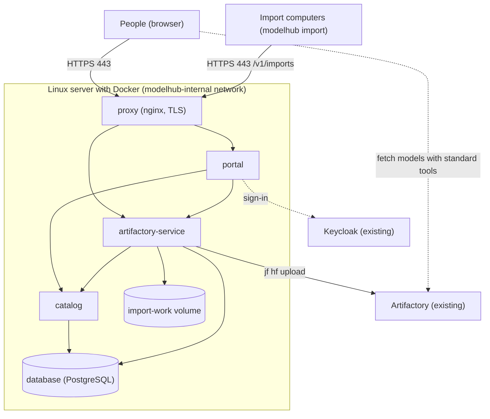

# Infrastructure Specification: platform

The hosting design for the whole system on the one Linux server with Docker: containers, networks, volumes, secrets, entry point, the image path through the internal registry, and the upgrade-and-return steps. One production stack only. The entry point is a reverse proxy container in our stack (infrastructure question 1 A).

## Deployment

| Facet | Choice | Rationale |
|---|---|---|
| Compute model | Docker Engine with the Compose plugin (v2) on one Linux server that already has Docker; five containers: proxy, portal, catalog, artifactory-service, database | FR6.1; no orchestrator |
| Networking | One internal Docker network (`modelhub-internal`) for all service traffic; only the proxy publishes a host port (443); the database, Catalog, portal and service ports are never published | NFR5.3 |
| TLS | The proxy terminates TLS with the organisation's certificate and key, mounted as secret files; plain http is refused or redirected; one host name for everything | NFR5.4 |
| Routing | `/` goes to the portal; `/v1/imports` and below goes to artifactory-service (the CLI); `/v1/retention`, `/v1/trusted-keys` are reached only by the portal on the internal network, not through the proxy; the Catalog is not routed at all | Smallest reachable surface |
| Storage | Named volumes: `catalog-db` (100 GB, database data, survives restarts and upgrades) and `import-work` (500 GB, import working files); separate so a full import disk cannot stop the database | NFR7.1, NFR7.2, NFR5.9 |
| Secrets | Compose file-backed secrets mounted under /run/secrets: database_password, token_hash_pepper, keycloak_client_secret (portal), artifactory_token, the service's own Keycloak client secret, and the certificate and key; created by an operator script; none in an image, environment variable or the Compose file | NFR5.1 |
| Images | Official Debian-based images (python:3.12-slim, postgres:16, nginx) mirrored by digest; the Compose file names release tags and digests, never latest | NFR9.2, NFR5.7 |
| Environments | Production only; developers run the same Compose file on their machines with the Artifactory stand-in and a local Keycloak stand-in; a staging stack could be started later under another project name | Infrastructure question 1 A (at the Catalog) |
| Infrastructure as code | The Compose file, the proxy configuration, the database set-up step and the operator script, all in the repository and reviewed like code | Reproducible |
| Resource sizing | Server minimum: 4 cores, 16 GB memory, 100 GB + 500 GB volumes plus the system and images (about 50 GB); container limits: database 4 GB, Catalog 1 GB, artifactory-service 2 GB, portal 1 GB, proxy 256 MB | NFR7.2 |
| Restart and start order | All containers restart on failure; database first; Catalog and artifactory-service wait for the database's health; the portal waits for the Catalog; the proxy last | NFR3.1 |
| Run-as | Each container as its own non-root user, read-only root file system, capabilities dropped, no new privileges | NFR5.2 |

## Infrastructure Services

| Service | Role | Configuration | Notes |
|---|---|---|---|
| proxy (nginx) | Entry point and TLS termination | Publishes 443; routes as above; request size limit set for pieces (no body limit on piece upload paths, a read timeout of 600 seconds there); access log to standard output | Official image; certificate files from secrets |
| portal | Web pages for people | See the portal unit | Internal only |
| catalog | Model information, trail and tokens | See the catalog unit | Internal only |
| artifactory-service | Import, keys and retention | See the artifactory-service unit | CLI calls reach it only through the proxy path /v1/imports |
| database (PostgreSQL 16) | One database server, one schema and one user per service, plus a migration role | Created by the database set-up step on first start; data on `catalog-db` | Internal only |
| Keycloak (outside) | Sign-in and tokens | Existing; clients `modelhub` (portal) and `modelhub-artifactory-service`; realm role `modelhub-admin` | Maintained by the Keycloak administrators |
| Artifactory (outside) | Holds the models | Existing; Hugging Face repository (Machine Learning layout) and a service account | Maintained by its administrators |
| Internal container registry (outside) | Where images are pulled from on the server | Images arrive by the server pack | Existing |
| Central logging and monitoring (outside) | Collects standard output and polls health | No agent in our containers | Existing |

## Shared Infrastructure

| Shared Resource | Owner Unit | Consumer Units | Access Boundary |
|---|---|---|---|
| Internal Docker network | platform | all containers | Not published; only the proxy joins the host's network |
| Database container and volume `catalog-db` | platform | catalog, artifactory-service | One schema and user each; migration role separate |
| Volume `import-work` | platform | artifactory-service | Only that container mounts it |
| Secret files | platform | each service | Each container mounts only its own |

## Architecture Diagram

Text fallback: people and the import computers reach only the proxy over HTTPS. The proxy forwards the web pages to the portal and the import calls to artifactory-service. The portal calls the Catalog and artifactory-service; artifactory-service calls the Catalog and uploads to the existing Artifactory; the Catalog and artifactory-service use the database; artifactory-service uses the import working volume. Sign-in is with the existing Keycloak. People download models directly from Artifactory with standard tools, not through our containers.

## Compose Services At A Glance

| Service | Image | Published | Volumes | Secrets | Waits for |
|---|---|---|---|---|---|
| database | postgres:16 | none | catalog-db | database_password | none |
| catalog | python:3.12-slim (app) | none | none | database_password, token_hash_pepper | database |
| artifactory-service | python:3.12-slim (app + jf) | none | import-work | database_password, keycloak_client_secret_service, artifactory_token | database, catalog |
| portal | python:3.12-slim (app) | none | none | keycloak_client_secret_portal | catalog |
| proxy | nginx | 443 | none | tls_certificate, tls_key | portal, artifactory-service |

## First Install Steps

1. Check the server: Docker and Compose present, volumes of 100 GB and 500 GB, the host name and certificate available.
2. Ask the Keycloak administrators for the clients `modelhub` and `modelhub-artifactory-service` and the realm role `modelhub-admin`; ask the Artifactory administrators for a Hugging Face repository (Machine Learning layout) and a service account with deploy and delete rights on it only.
3. Verify the signed server pack with the trusted key; load the images into the internal registry (or directly into Docker) by digest.
4. Run the operator script: it creates the secret files (random ones generated, external ones asked for) and the database users.
5. Start the stack with Compose; the database set-up and the migrations run; wait for every health check to turn green.
6. Sign in as an administrator, add the first trusted signing key (typing back its fingerprint), make a personal token and run a first import.

## Upgrade And Return Steps

Upgrade: (1) verify and load the new server pack; (2) note the running tags; (3) stop the stack with the 60-second grace; (4) change the tags in the Compose file to the new release; (5) start; the database steps run under a lock; (6) wait for the health checks; (7) sign in and look at the list. Return: (1) stop; (2) put the noted tags back; (3) start. The previous images stay on the server and in the registry; a database step that removed data is never released in the same version that stopped using it. The whole procedure is rehearsed once from an old release to a new one and back (AC6.2).

## Not Covered Here

Backup of the database and working volumes was left to a later phase in the scope. The design keeps the data on named volumes so that a stop-and-copy backup works today; restore of the Artifactory repository is Artifactory's own matter.
