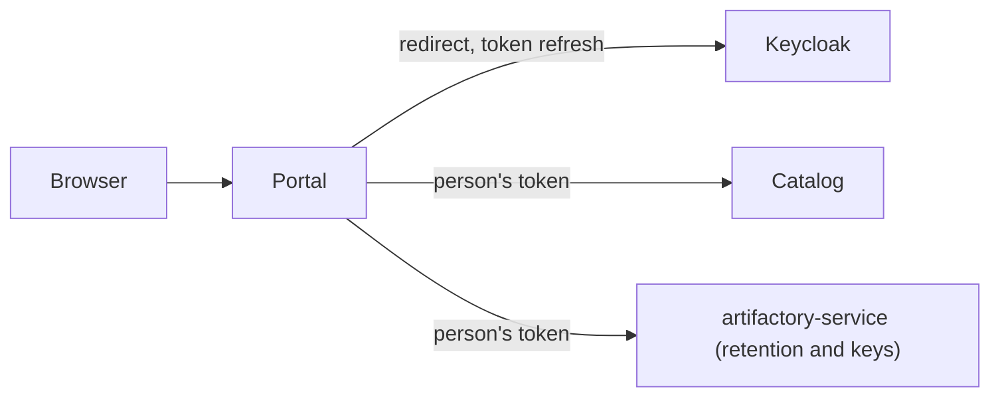

# Functional Specification: portal

The portal is the web app people use, grown from the prototype in `web/`. This file is the source of truth for the screens, the journeys and the session. It has no entities of its own beyond the session; the data comes from the Catalog (contracts C2, C3) and the retention service (C4). Decision rules are BR1.1 to BR1.17 in `rules.md`. Screen components are in `frontend-components.md`.

## Screens

| Screen | Address | Who | Source | Rules |
|--------|---------|-----|--------|-------|
| Sign-in and sign-out | /auth/login, /auth/callback, /auth/logout | everyone | Keycloak | BR1.1, BR1.2 |
| Models list | /models | signed in | Catalog list | BR1.5 |
| Model page | /{org}/{name} | signed in | Catalog model and version | BR1.6, BR1.7, BR1.8 |
| Files | /{org}/{name}/tree/{rev}[/dir] | signed in | Catalog version record | BR1.6, BR1.9 |
| File page | /{org}/{name}/blob/{rev}/{path} | signed in | Catalog file record | BR1.9 |
| Commits | /{org}/{name}/commits/{rev} | signed in | Catalog saved response | BR1.6 |
| Trail | /trail and /{org}/{name}/trail | signed in | Catalog trail plus retention decisions | BR1.15 |
| Personal tokens | /account/tokens | signed in | Catalog tokens | BR1.12 |
| Retention | /admin/retention | read by all, changed by administrators | retention service | BR1.13 |
| Trusted keys | /admin/keys | administrators | retention service | BR1.14 |
| Problem pages | any | everyone | portal | BR1.11 |
| Health | /healthz, /readyz | open | portal | BR1.1 |

The prototype's download and raw routes (`/resolve/...`, `/raw/...`) are removed (BR1.9). The JSON routes of the prototype (`/api/...`) are removed; other programs use the Catalog, which has its own interface.

## Journey J1: Sign In And Browse

1. A person opens any address; with no session they are sent to Keycloak. [BR1.1]
2. After the callback the server stores the tokens and sets the session cookie. [BR1.2]
3. They land on the models list, filter and sort it, search, and open a model. [BR1.5, BR1.6]
4. The model page shows the card and the fetch instructions. [BR1.6, BR1.8]

## Journey J2: Make A Token For The CLI

1. The person opens the token page and enters a name. [BR1.12]
2. The portal asks the Catalog to make it and shows the value once, with a warning to copy it. [BR1.12]
3. They paste it into `modelhub login`. Later they can see it in the list (first characters only) or revoke it. [BR1.12]

## Journey J3: Administrator Decides Retention

1. The administrator opens the retention page and sees the period and the versions past it. [BR1.13, BR1.4]
2. For one version they choose keep (age restarts) or remove. [BR1.13]
3. Remove shows a confirmation; after confirming, the result page says done, failed (with the reason) or files deleted but not marked (try again). [BR1.13]
4. The decision appears in the trail. [BR1.15]

## Journey J4: Administrator Trusts A Signing Key

1. The administrator opens the keys page, pastes the public key file, enters a label and the fingerprint they have confirmed. [BR1.14]
2. A mismatch is shown and nothing is added; a match adds the key. [BR1.14]

## Journey J5: A Service Is Down

1. The Catalog cannot be reached: the page says so with a retry link and shows no model data. [BR1.11]
2. Keycloak cannot be reached: new sign-ins show a message; signed-in people continue while their access token is valid. [BR1.11]

## Session State

| From | Event | To | Rule |
|------|-------|----|------|
| none | callback succeeds | active | BR1.2 |
| active | request within 8 hours | active (idle clock restarts) | BR1.2 |
| active | access token near expiry, refresh works | active | BR1.2 |
| active | refresh fails, Keycloak down | active, token expired (asks to sign in again when needed) | BR1.11 |
| active | refresh refused | none | BR1.2 |
| active | idle over 8 hours | none | BR1.2 |
| active | sign-out | none | BR1.2 |
| any | portal restarts | none | BR1.2 |

## Edge Cases Settled

- **Pasting a model address of a model not imported.** A plain 'not found' page. [BR1.6]
- **A revision that is a branch name or a short commit.** Resolved against the Catalog's refs and captured commits, as in the prototype; ambiguous short commits ask for more characters. [BR1.6]
- **A very long README or many files.** Paged or cut with a notice as in the prototype; nothing is read beyond what the Catalog returns. [BR1.6]
- **A person revokes the token the CLI is using.** The next import is refused with a message to make a new one. [BR1.12]
- **Keycloak's access token lifetime.** Requirement FR3.8 says signed-in people keep working until their session ends if Keycloak is down; this holds only while the access token is valid. Longer access tokens would stretch it. Recorded as an open question for the Keycloak administrators.
- **Two administrators on the same version.** The second sees the first's result as 'already decided' (the service answers 409). [BR1.13]
- **Cross-site forms.** Refused. [BR1.3]

## Derived: Session And Services Diagram

Text fallback: the browser talks only to the portal; the portal talks to Keycloak, the Catalog and the retention and key part of artifactory-service, using the person's token. It never talks to Artifactory or the database.

## Derived: Rules Summary

17 rules in `rules.md`: access (BR1.1 to BR1.4), browsing (BR1.5 to BR1.10), failure (BR1.11), accounts and administration (BR1.12 to BR1.15), logging and look (BR1.16, BR1.17).
