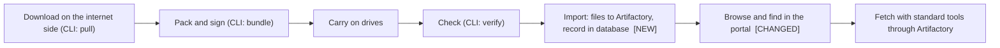

# Scope Document

Inputs: `intent-statement` (`ideation/intent-capture/`), `feasibility-assessment` and `constraint-register` (`ideation/feasibility/`), and your answers in `scope-definition-questions.md` (written SQ). Intent capture answers are written IQ and feasibility answers FQ.

## Purpose Of The Work

Make the CLI and the web app enterprise level: after a bundle is verified on the air-gapped side the CLI puts the model into Artifactory and records its information in a PostgreSQL database; the web app becomes the portal that reads that database; and the whole is hosted in Docker containers. The approved workflow stops at the architecture, so this stage defines both what the architecture covers and what the first build covers (SQ4).

## Scope Boundary

### In The Architecture Design (the whole system, SQ4)

| Part | Summary | Source |
|------|---------|--------|
| Model import | The CLI verifies a bundle, uploads the model to Artifactory with `jf hf upload`, records it in the database, and skips a model whose same commit is already there | IQ6, FQ9, FQ10, FQ13 |
| Metadata database | PostgreSQL holding model information, file lists, licences, and who imported what, when, from which bundle and with which signing key | IQ3, IQ7, FQ3 |
| Portal | The prototype web app grown into the portal: reads the database, links to Artifactory for downloads, signs people in with Keycloak | IQ8, IQ21, SQ7 |
| Container hosting | Docker Compose on one Linux server; images reach it through the internal container registry; logs and monitoring go to the central systems | IQ9, IQ10, FQ1, FQ8 |
| Artifactory stand-in | An emulation used only to build and test, not delivered | IQ17, IQ22, IQ24 |
| Retention rule | A rule for how long old model versions are kept | FQ3, SQ2 |
| Central logging and monitoring | The new parts report into what already exists | FQ1, SQ2 |
| Import of the old folder store | Bringing the models already unpacked in the old folder into the new store with the same CLI | FQ12, SQ8 |

### In The First Build

The smallest useful first version is the CLI import into Artifactory with a database record, plus the portal reading the database with Keycloak sign-in (SQ1 B). Added to it from SQ2: the retention rule and reporting into central logging and monitoring. Importing the old folder's models is later (SQ8 A). The build order is dependency-first: the data model, then the import, then the portal (SQ3 C).

### Out Of The First Build, Designed But Built Later

- Importing the models already in the old folder store (SQ8 A).
- Backup and restore of the database and the stored files (not picked in SQ2).
- A documented way for pipelines to fetch models (not picked in SQ2); they can use Artifactory's own download in the meantime.

### Out Of Scope

- Private or gated models, and automatic updates of models already imported (IQ14).
- Scanning imported files for malicious content (not selected in FQ3).
- Datasets and Spaces: the intent speaks only of models, and Artifactory does not support Spaces (`feasibility-assessment`, E7).
- Searching inside model files or running the models: not selected as a left-out item in IQ14 and not asked for either, so it is simply not planned. Anything not named in the intent statement is not in scope.

## Priorities

Qualities that matter most for "enterprise level": security (sign-in, roles, and a trail of who imported what) and operability (central logging and monitoring, simple upgrades) (SQ6). Reliability and speed for very large models were not picked, so they are designed for sensibly but do not drive the design. The prioritized list is in `intent-backlog.md`.

## Dependencies Between Parts

- The portal needs the database, and the database needs the data model first (SQ3 C).
- The import needs the database and the Artifactory stand-in, because no real Artifactory is available (IQ17).
- Container hosting needs every part to exist as an image, and the images must reach the server through the internal registry (FQ1).
- The retention rule needs the database to know what exists and Artifactory to remove files.

## Value Stream

A model's path from the internet to a person using it, with the parts this work changes marked.

Text fallback: download on the internet side, pack and sign, carry on drives, check, **import (files to Artifactory, record in the database)**, **browse and find in the portal**, fetch with standard tools through Artifactory. The first two steps and the check already exist; the import is new and the portal changes from reading a folder to reading the database.

## Timeline

A design is needed within about a month (FQ7). No capability has its own date (SQ5). The build has no date.

## Assumptions And Open Questions

- The first build's size is not estimated; only the design is due within a month [assumption]
- Backup and restore is left for later because it was not picked, not because it was judged unimportant; reliability was not chosen as a top quality (SQ6) [assumption]
- Artifactory's own download is enough for pipelines until a documented way is built [assumption]
- The retention period has no length yet (`raid-log` A5) [assumption]
