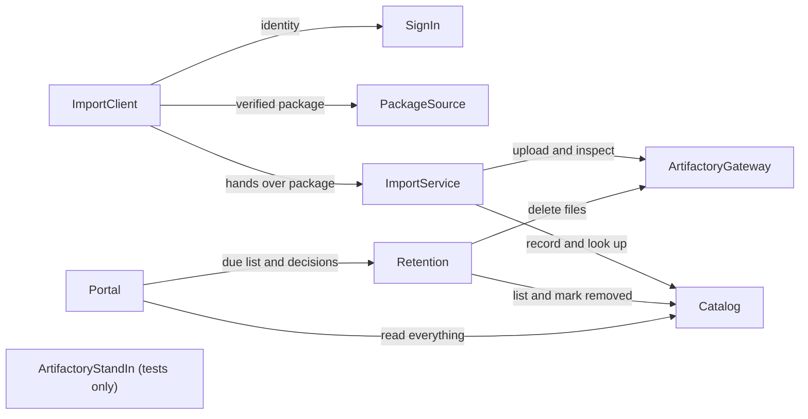

# Component Catalogue

Inputs: `requirements.md` (from `inception/requirements-analysis/`) and your answers in `domain-design-questions.md` (written DQ). Requirement IDs are written FR and NFR. Decisions are in `decisions.md`.

A component here is a building block of code you write. The database, Artifactory, Keycloak and the JFrog CLI are things components use, not components. How the components are grouped into containers is decided in the next stage (Units Generation).

## Catalogue

```yaml
components:
  - name: SignIn
    summary: Reads the person's personal token on the import computer and presents it when the CLI calls the import service.
    behaviour: >
      The person makes a personal token in the portal and gives it to the CLI once (changed by
      ADR-010; it needs no web browser or internet on the import computer). SignIn keeps it in a
      file only that person can read, reads it for each run and never prints it or writes it to a
      log. If there is no token, or the import service says it is expired or revoked, the import
      run stops before touching any model, says to make a new token in the portal, and the CLI
      exits with status 2.
    responsibilities:
      - Keep the personal token in a file only its owner can read
      - Present it to the import service; never print or log it
    depends_on: []
    dependents:
      - component: ImportClient
        interaction: needs the person's token to call the import service
    external_dependencies:
      - name: Local file with the personal token
        kind: other
        purpose: Where the person's token is kept on the import computer
    entities: []

  - name: PackageSource
    summary: Presents one model version, ready to import, from a bundle's pieces or from an old model-store folder.
    behaviour: >
      Reuses the existing verification and unpacking: checks the signature against the local trusted
      keys and every piece and file against the signed manifest, refuses unsafe paths, and reads the
      old model-store layout (C3) for the later folder import (FR8). Produces one import package per
      model version: its files, summary, README and pictures, saved Hugging Face responses, checksum
      manifest and the signed bundle description files. An unverifiable bundle is refused with the
      reason and nothing is handed on.
    responsibilities:
      - Verify a bundle on the import computer (fails fast)
      - Read an old model-store folder under the same rules
      - Present each model version as one import package
    depends_on: []
    dependents:
      - component: ImportClient
        interaction: asks for verified import packages
    external_dependencies:
      - name: Local disk and the local trusted-key list
        kind: other
        purpose: Where the pieces or old folder are read and the keys the person trusted
    entities: []

  - name: ImportClient
    summary: The CLI's import command: reads the packages, calls the import service, shows progress and the report, and sets the exit status.
    behaviour: >
      Takes one or a list of bundles or an old folder, asks SignIn for the person's identity and
      PackageSource for each verified package, sends each package to the import service, shows live
      progress for steps over 2 seconds, retries network errors with waits of 1, 2, 4, 8 and 16 seconds,
      and prints a report listing each model as imported, skipped, completed or failed with a reason. It
      never prints a token or password. Exit status is 0 when every model was imported or skipped, 1
      when at least one failed, 2 when it could not run.
    responsibilities:
      - Run the import command for one or many models
      - Show progress and the final report; set the exit status
      - Retry network errors while sending
    depends_on:
      - component: SignIn
        interaction: gets the person's identity before importing
        style: sync
      - component: PackageSource
        interaction: gets each verified import package
        style: sync
      - component: ImportService
        interaction: hands each package over for import
        style: sync
    dependents: []
    external_dependencies: []
    entities: []

  - name: ImportService
    summary: Server-side service that turns a verified package into a stored model: checks it again, decides skip or repair, uploads to Artifactory, records it in the Catalog.
    behaviour: >
      Accepts a package from an authenticated CLI, checks the personal token with the Catalog for the importer's identity,
      checks again the signature against its own trusted-key list and every file against the signed
      manifest, checks the model names against Artifactory's rules, and takes a lock for the model so
      two imports of the same model cannot run at once. It then decides: skip when the same model and
      commit are fully imported, finish only the Catalog part when the files are already in Artifactory,
      upload again when the Catalog has a record but Artifactory has no files, or do the whole import.
      Uploading is done through the ArtifactoryGateway and the record through the Catalog, so a stopped
      import can be run again to a correct result. It never overwrites an existing version.
    responsibilities:
      - Re-verify the bundle's signature and files against its own trusted keys
      - Decide skip, repair or full import for each model
      - Hold a per-model lock and a job record so an import can be repeated safely
      - Own the list of trusted signing keys
    depends_on:
      - component: ArtifactoryGateway
        interaction: checks what Artifactory holds and uploads the model files
        style: sync
      - component: Catalog
        interaction: checks what is recorded and records the version and its import-trail row
        style: sync
    dependents:
      - component: ImportClient
        interaction: receives packages and returns the per-model result
    external_dependencies:
      - name: Keycloak
        kind: third-party-api
        purpose: Validates the importer's token
      - name: PostgreSQL
        kind: database
        purpose: Holds the import jobs and the trusted keys (its own tables)
    entities:
      - name: ImportJob
        identifier: jobId
        attributes: [jobId, modelId, commit, state, startedBy, startedAt, finishedAt, failureReason, bundleName]
        references:
          - entity: ModelVersion
            owned_by: Catalog
            relationship: each ImportJob is for one model version
      - name: TrustedKey
        identifier: keyId
        attributes: [keyId, fingerprint, name, addedBy, addedAt, status]

  - name: ArtifactoryGateway
    summary: The one place that talks to Artifactory: uploads a model, says what a repository holds, deletes a version, and knows Artifactory's naming and layout rules.
    behaviour: >
      Uploads a model's files with `jf hf upload` using the model id as repository id and the commit hash
      as the revision, never asking Artifactory to overwrite. Checks whether a version's files exist and
      what checksums Artifactory reports, deletes a version's files on request, and checks names against
      Artifactory's rules (organisation, model and revision). Reports a refused name, a 409 or a network
      error with its reason so callers can decide.
    responsibilities:
      - Upload model files to a Hugging Face repository in Artifactory
      - Inspect and delete versions in Artifactory
      - Know and apply Artifactory's naming and layout rules
    depends_on: []
    dependents:
      - component: ImportService
        interaction: uploads and inspects when importing
      - component: Retention
        interaction: deletes a version when an administrator decides to remove it
    external_dependencies:
      - name: Artifactory
        kind: third-party-api
        purpose: Stores the model files in a Hugging Face repository
      - name: JFrog CLI with Python 3 and a supported huggingface_hub
        kind: other
        purpose: Runs `jf hf upload`
    entities: []

  - name: Catalog
    summary: The data interface: owns all model information, the stored documents and the import trail, and answers lists, filters, sorts and searches.
    behaviour: >
      Checks the caller's Keycloak token and role on every call. Stores a model version, its files, its
      documents and its import-trail row in one transaction, so either all are stored or none are.
      Stores a value Hugging Face did not give as empty, never as zero. Keeps unknown fields in the
      saved responses. Answers the model list with filters (task, library, licence, language, size),
      sorting (including by import time and importer) and 30 per page, and searches model-card text.
      Marks a version removed on request from Retention. Makes, lists, revokes and checks personal
      tokens (ADR-010): a signed-in person asks for one, it is shown once, only its hash is stored,
      it works for importing only and expires. It is the only component that reads or writes
      model information, the import trail and the personal tokens; the import service and Retention
      keep only their own records (see their entities) in their own tables of the same PostgreSQL.
    responsibilities:
      - Be the only reader and writer of model information and the import trail
      - Store a version, files, documents and the trail row atomically
      - Answer lists, filters, sorts and text searches quickly
      - Mark versions removed
    depends_on: []
    dependents:
      - component: ImportService
        interaction: asks what is recorded and records new versions and trail rows
      - component: Retention
        interaction: lists versions by age and marks versions removed
      - component: Portal
        interaction: reads every model, file, document and trail view
    external_dependencies:
      - name: PostgreSQL
        kind: database
        purpose: Holds model information, stored documents and the import trail
      - name: Keycloak
        kind: third-party-api
        purpose: Validates tokens and roles
    entities:
      - name: Model
        identifier: modelId
        attributes: [modelId, firstImportedAt, latestCommit]
      - name: ModelVersion
        identifier: versionKey
        attributes: [versionKey, modelId, commit, capturedAt, licence, language, tags, task, library, downloads, likes, usedStorageBytes, parameterCounts, createdAt, lastModified, state, repositoryKey, importedAt, removedAt]
      - name: VersionFile
        identifier: versionKey and path
        attributes: [versionKey, path, sizeBytes, sha256, fileType, scan, downloadedToStore]
      - name: StoredDocument
        identifier: versionKey, kind and name
        attributes: [versionKey, kind, name, contentType, sizeBytes, sha256, content]
      - name: ImportRecord
        identifier: recordId
        attributes: [recordId, versionKey, importedBy, importedAt, computer, bundleName, bundleSha256, signingKeyFingerprint, toolVersion, checkResults, outcome]
      - name: PersonalToken
        identifier: tokenId
        attributes: [tokenId, personSubject, personName, name, tokenHash, prefix, scope, createdAt, expiresAt, lastUsedAt, revokedAt]

  - name: Retention
    summary: Owns the retention setting and the keep-or-remove decisions, and carries out a removal.
    behaviour: >
      Holds the retention period (default 1 year, changeable by an administrator) and lists versions
      older than it, counted from import time, for administrators. For each listed version an
      administrator decides keep (age restarts) or remove. Nothing is removed without that decision for
      that version. Removing deletes the files through the ArtifactoryGateway and then asks the Catalog
      to mark the version removed; if the deletion fails the version is not marked and the failure is
      shown. Refuses anyone without the administrator role.
    responsibilities:
      - Hold the retention setting
      - List versions past the period
      - Record each decision and carry out a removal in two steps
      - Refuse non-administrators
    depends_on:
      - component: Catalog
        interaction: lists versions by age and marks a version removed
        style: sync
      - component: ArtifactoryGateway
        interaction: deletes the version's files
        style: sync
    dependents:
      - component: Portal
        interaction: shows the due list and sends the administrator's decisions
    external_dependencies:
      - name: Keycloak
        kind: third-party-api
        purpose: Validates the administrator role
      - name: PostgreSQL
        kind: database
        purpose: Holds the setting and the decisions (through its own tables)
    entities:
      - name: RetentionSetting
        identifier: settingKey
        attributes: [settingKey, value, changedBy, changedAt]
      - name: RetentionDecision
        identifier: decisionId
        attributes: [decisionId, versionKey, decision, decidedBy, decidedAt, outcome]
        references:
          - entity: ModelVersion
            owned_by: Catalog
            relationship: each RetentionDecision is about one model version

  - name: Portal
    summary: The web app people use: pages, sign-in, safe rendering of model cards, fetch instructions, and the administrator screens.
    behaviour: >
      Requires a Keycloak sign-in for every page. Has a page where a person makes, sees and revokes
      their personal tokens for the CLI (ADR-010). Reads everything from the Catalog and shows the
      models list with filters and sort, the model card, files and versions, commit history and the
      revision menu. Adds filter and sort by import time and importer, text search, and the import
      trail view. For each model shows how to fetch it from Artifactory with standard tools. Renders
      model-card text safely: it is sanitised, nothing is requested from outside the organisation, and
      files are never rendered in the portal's own address. Shows retention screens to administrators
      only. Says plainly when the Catalog or Keycloak cannot be reached and shows no stale data.
    responsibilities:
      - Sign people in and show pages to them
      - Render model cards safely
      - Show fetch instructions, the import trail and the retention screens
    depends_on:
      - component: Catalog
        interaction: reads all model information and the trail
        style: sync
      - component: Retention
        interaction: shows what is due and sends administrators' decisions
        style: sync
    dependents: []
    external_dependencies:
      - name: Keycloak
        kind: third-party-api
        purpose: Signs people in and supplies the administrator role
    entities: []

  - name: ArtifactoryStandIn
    summary: A test-only imitation of Artifactory's Hugging Face repository and the other calls the system makes, used to build and test without a real Artifactory.
    behaviour: >
      Answers the calls `jf hf upload`, `snapshot_download`, listing a repository, reading checksums and
      deleting a version make, following JFrog's documented behaviour: the naming rules, a 409 answer
      when a version exists without overwrite permission, and revisions as commit hashes. Every behaviour
      it assumes is written down, with a checklist of those to confirm on a real Artifactory. It is not
      delivered and nothing in the delivered system depends on it.
    responsibilities:
      - Imitate the documented Artifactory behaviour for tests
      - Record the assumed behaviours and the checklist for the real system
    depends_on: []
    dependents: []
    external_dependencies: []
    entities: []
```

## Component Diagram



Text fallback: ImportClient calls SignIn, PackageSource and ImportService. ImportService calls ArtifactoryGateway and Catalog. Retention calls ArtifactoryGateway and Catalog. Portal calls Catalog and Retention. ArtifactoryStandIn is used only by tests and nothing calls it.

## Component Summary

| Component | Purpose | Depends On | Dependents | Entities Owned |
|-----------|---------|------------|------------|----------------|
| SignIn | Holds and presents the personal token on the import computer | none | ImportClient | none |
| PackageSource | Verified import packages from bundles or an old folder | none | ImportClient | none |
| ImportClient | The CLI import command, report and exit status | SignIn, PackageSource, ImportService | none | none |
| ImportService | Re-verify, decide, upload, record | ArtifactoryGateway, Catalog | ImportClient | ImportJob, TrustedKey |
| ArtifactoryGateway | The one place that talks to Artifactory | none | ImportService, Retention | none |
| Catalog | The data interface, all model information, and personal tokens | none | ImportService, Retention, Portal | Model, ModelVersion, VersionFile, StoredDocument, ImportRecord, PersonalToken |
| Retention | Retention setting, decisions and removal | Catalog, ArtifactoryGateway | Portal | RetentionSetting, RetentionDecision |
| Portal | The web app | Catalog, Retention | none | none |
| ArtifactoryStandIn | Test-only imitation of Artifactory | none | none | none |

## Entity Ownership

| Entity | Owning Component | Identifier | Attributes | References |
|--------|------------------|------------|------------|------------|
| ImportJob | ImportService | jobId | jobId, modelId, commit, state, startedBy, startedAt, finishedAt, failureReason, bundleName | ModelVersion (Catalog): each ImportJob is for one model version |
| TrustedKey | ImportService | keyId | keyId, fingerprint, name, addedBy, addedAt, status | none |
| Model | Catalog | modelId | modelId, firstImportedAt, latestCommit | none |
| ModelVersion | Catalog | versionKey | versionKey, modelId, commit, capturedAt, licence, language, tags, task, library, downloads, likes, usedStorageBytes, parameterCounts, createdAt, lastModified, state, repositoryKey, importedAt, removedAt | none |
| VersionFile | Catalog | versionKey and path | versionKey, path, sizeBytes, sha256, fileType, scan, downloadedToStore | none |
| StoredDocument | Catalog | versionKey, kind and name | versionKey, kind, name, contentType, sizeBytes, sha256, content | none |
| ImportRecord | Catalog | recordId | recordId, versionKey, importedBy, importedAt, computer, bundleName, bundleSha256, signingKeyFingerprint, toolVersion, checkResults, outcome | none |
| PersonalToken | Catalog | tokenId | tokenId, personSubject, personName, name, tokenHash, prefix, scope, createdAt, expiresAt, lastUsedAt, revokedAt | none |
| RetentionSetting | Retention | settingKey | settingKey, value, changedBy, changedAt | none |
| RetentionDecision | Retention | decisionId | decisionId, versionKey, decision, decidedBy, decidedAt, outcome | ModelVersion (Catalog): each RetentionDecision is about one model version |

## External Dependencies

| Component | Dependency | Kind | Purpose |
|-----------|------------|------|---------|
| SignIn | Local file with the personal token | other | Where the person's token is kept on the import computer |
| PackageSource | Local disk and the local trusted-key list | other | Where pieces or an old folder are read, and the keys the person trusted |
| ImportService | Keycloak | third-party-api | Validates the importer's token |
| ImportService | PostgreSQL | database | Import jobs and trusted keys (its own tables) |
| ArtifactoryGateway | Artifactory | third-party-api | Stores the model files |
| ArtifactoryGateway | JFrog CLI with Python 3 and a supported `huggingface_hub` | other | Runs `jf hf upload` |
| Catalog | PostgreSQL | database | Model information, stored documents and the trail |
| Catalog | Keycloak | third-party-api | Validates tokens and roles |
| Retention | Keycloak | third-party-api | Validates the administrator role |
| Retention | PostgreSQL | database | The setting and the decisions |
| Portal | Keycloak | third-party-api | Signs people in and supplies the administrator role |

## Rationale

| Component | Why it is a separate building block |
|-----------|--------------------------------------|
| SignIn | A distinct concern with its own failure (token missing, expired or revoked) and its own change rate (how the CLI holds credentials changes independently of importing; changed by ADR-010) |
| PackageSource | Existing, tested verification code with a different change rate from the import; it must also serve the later old-folder import |
| ImportClient | The only component the person runs; owns the report and exit status, which change with CLI behaviour and not with server rules |
| ImportService | Owns the decision rules (skip, repair, names, lock) and the job record; distinct lifecycle from the Catalog because its data is in-progress work, not model information (DQ1 B) |
| ArtifactoryGateway | One place for Artifactory's rules, which JFrog can change (risk R8); isolates the only dependency on the JFrog CLI and an older Python (DQ5 A) |
| Catalog | Owns all model information and the import trail, and is the only component that reads or writes them (DQ2 A, DQ3 A); a distinct data lifecycle from in-progress imports and from retention |
| Retention | Owns a destructive action and its own data; kept apart so the Catalog never holds deletion rights (DQ4 A) |
| Portal | Distinct concern: people, pages and safe rendering; changes with the interface, not with the data |
| ArtifactoryStandIn | Test-only, different change rate, and must stay out of the delivered system (IQ24 A) |

### Alternatives Rejected

- Import done inside the CLI (DQ1 option A): rejected because you chose a server-side import service (DQ1 B); it would have put the older Python environment on every import computer (R1).
- The importer or the portal writing the database directly (DQ2 B, DQ3 B): rejected for database logins on import computers and two copies of the rules.
- Retention inside the Catalog (DQ4 B): rejected so the Catalog never holds deletion rights over Artifactory.
- Two Artifactory gateways (DQ5 B): rejected because Artifactory's naming and layout rules would be written twice.
- The service trusting the CLI's verification alone (DQ6 A): rejected so the trail's signing key is checked on the server.

## Open Questions

- OQ1 (answered in Contract Design) The CLI signs in with a personal token made in the portal (ADR-010).
- OQ2 (answered in Contract Design) The CLI sends the bundle's pieces, one request each (contract C1).
- OQ3 (answered in Contract Design) An administrator adds a trusted key by sending the key file and typing its fingerprint (contract C4).
- OQ4 Should a skipped model also leave a trail row? Skipped imports are not recorded in this design. For functional design.
- OQ5 (answered in Contract Design) A long import is a job the CLI starts and asks about until it ends (contract C1).
