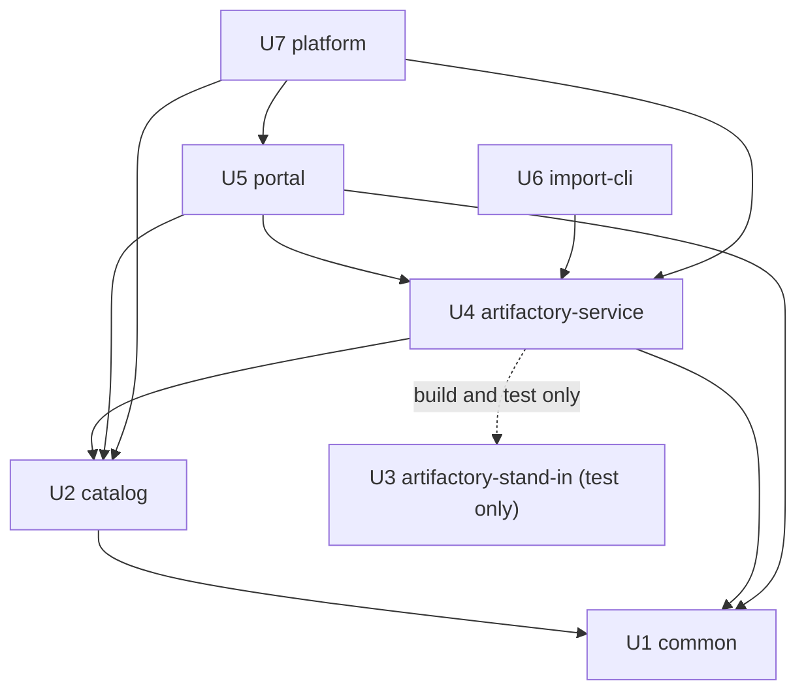

# Unit Dependencies

This describes only what depends on what (the topology). It does not choose a build order or a critical path; Delivery Planning does that using this graph.

## Dependency Graph

An arrow reads "depends on". Each edge is either needed when the system runs, or needed only to build and test.

| Unit | Depends on | Why |
|------|------------|-----|
| U1 common | none | Shared code with no dependencies of its own |
| U2 catalog | U1 | Uses the shared token check, secrets, logging and health helpers (runtime) |
| U3 artifactory-stand-in | none | Stands alone; imitates Artifactory |
| U4 artifactory-service | U1, U2, U3 | U1: token check, secrets, logging, health (runtime). U2: records versions and trail rows, marks versions removed (runtime). U3: the imitation it is built and tested against (build and test only) |
| U5 portal | U1, U2, U4 | U1: token check, secrets, logging, health (runtime). U2: reads all model information (runtime). U4: the retention screens call Retention in the artifactory-service (runtime) |
| U6 import-cli | U4 | Sends each verified package to the import service (runtime) |
| U7 platform | U2, U4, U5 | Builds the images and the Compose file for the three containers (build) |



Text fallback: catalog depends on common. artifactory-service depends on common, catalog and (for testing only) artifactory-stand-in. portal depends on common, catalog and artifactory-service. import-cli depends on artifactory-service. platform depends on catalog, artifactory-service and portal. common and artifactory-stand-in depend on nothing. There are no cycles.

## Integration Points Between Units

| From | To | What crosses | Notes for Contract Design |
|------|----|--------------|---------------------------|
| U6 import-cli | U4 artifactory-service | A verified package: model files, summary, README and pictures, saved responses, manifest, bundle description files, and the person's Keycloak token | The largest transfer in the system (files over 100 GB) (OQ2); long-running (OQ5) |
| U4 artifactory-service | U2 catalog | Lookups of what is recorded; a version, its files, documents and trail row to store; a request to mark a version removed | Must store the version and trail row in one transaction (FR2.5) |
| U5 portal | U2 catalog | Every read of model information; the import-trail view; searches and filters | Must meet the 1 second target (NFR2) |
| U5 portal | U4 artifactory-service | The due list for retention; an administrator's keep or remove decision; the trusted-key list (administrator) | Administrator role required (FR4.3) |
| U4 artifactory-service | Artifactory | Upload with `jf hf upload`; checks of what a repository holds; deletes | Against U3 in tests |
| U2, U4, U5 | Keycloak | Token validation and role | Through U1 |
| U6 import-cli | Keycloak | The person's sign-in | OQ1 |

## Parallel Development Opportunities

Sets of units with no dependency between them, which can be designed or built at the same time:

- U1 and U3 depend on nothing, so they can be done together.
- After U1: U2 can run alongside U3.
- After U2 and U3 are done: U4 and the work on the shared parts of U7 (images for U2) are independent of each other.
- U5 and U6 are independent of each other; both need U4.

These are possibilities only. Whether anything is actually done in parallel is a Delivery Planning choice (the owner works alone with the assistant, so it may all be in sequence).

## Walking Skeleton

Not applicable: the walking-skeleton ceremony is off for this piece of work (the classic scope), so no unit is shaped as an integrated first slice.

## Dependency Edge Block

```yaml
units:
  - name: common
    kind: library
    depends_on: []
  - name: catalog
    kind: service
    depends_on: [common]
  - name: artifactory-stand-in
    kind: service
    depends_on: []
  - name: artifactory-service
    kind: service
    depends_on: [common, catalog, artifactory-stand-in]
  - name: portal
    kind: ui
    depends_on: [common, catalog, artifactory-service]
  - name: import-cli
    kind: service
    depends_on: [artifactory-service]
  - name: platform
    kind: packaging
    depends_on: [catalog, artifactory-service, portal]
```
