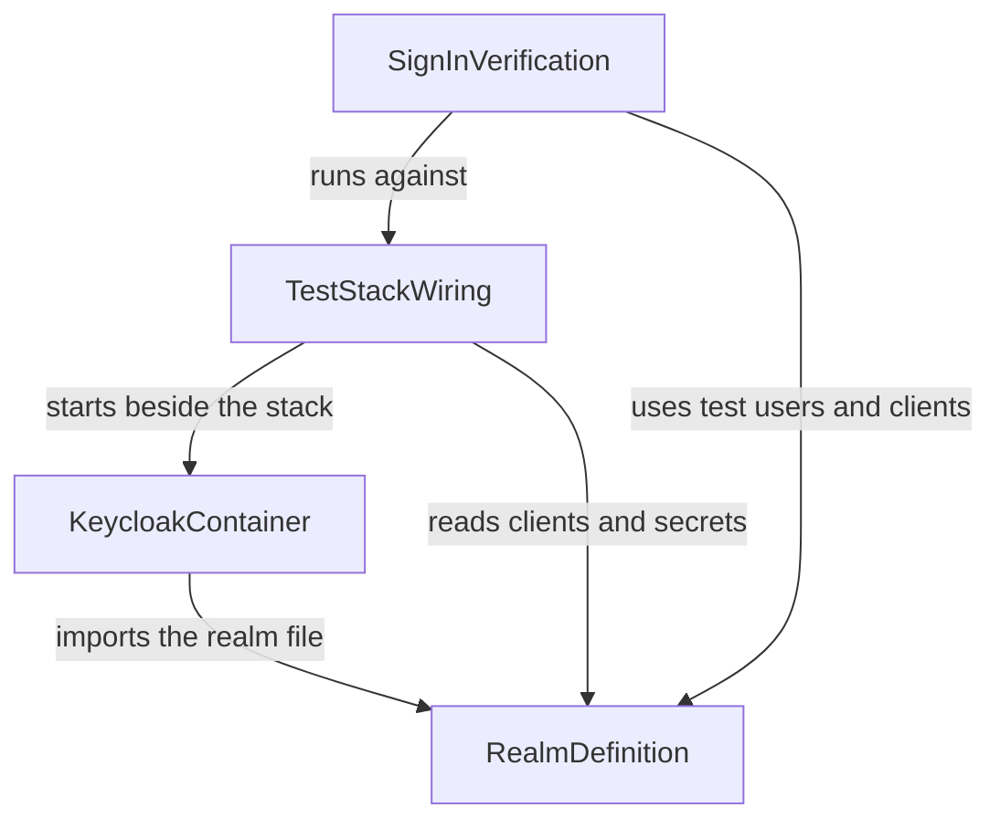

# Component Catalogue

```yaml
components:
  - name: RealmDefinition
    summary: The realm file that holds every Keycloak setting ModelHub needs, and the check of it.
    behaviour: >
      One realm named modelhub. Role modelhub-admin. Client modelhub (portal): confidential,
      authorisation code with S256 proof key, scope openid, redirect and logout addresses of the
      test portal, an audience mapper so access tokens carry the audience modelhub. Client
      modelhub-artifactory-service (import service): confidential, client credentials only, audience
      mapper to modelhub. Two test users (ordinary, administrator holding modelhub-admin). Every
      secret and password is a plainly marked test value.
    responsibilities:
      - Hold the single source of the Keycloak settings
      - Provide a check that the file has every name, flow, role, user and mapper the code needs
      - Mark every secret as a test value
    depends_on: []
    dependents:
      - component: KeycloakContainer
        interaction: imports the file when it starts
      - component: TestStackWiring
        interaction: takes the client ids, secrets and issuer from it
      - component: SignInVerification
        interaction: signs in as its test users with its clients
    external_dependencies: []
    entities:
      - name: Realm
        identifier: name
        attributes: [name, issuer]
      - name: Client
        identifier: clientId
        attributes: [clientId, flow, secret, audience]
        references:
          - entity: Realm
            owned_by: RealmDefinition
            relationship: each Client belongs to the one Realm
      - name: TestUser
        identifier: username
        attributes: [username, password, roles]
        references:
          - entity: Realm
            owned_by: RealmDefinition
            relationship: each TestUser belongs to the one Realm
  - name: KeycloakContainer
    summary: The compose file that starts one Keycloak from a pinned official image with the realm imported.
    behaviour: >
      Starts in development mode with no certificate and no external database, under one fixed
      address the browser and the other containers can both use; ready when the realm's discovery
      address answers; makes no call to the internet.
    responsibilities:
      - Pin the image to an exact version
      - Import the realm file at start
      - Provide a health check on the discovery address
    depends_on:
      - component: RealmDefinition
        interaction: imports the realm file
        style: sync
    dependents:
      - component: TestStackWiring
        interaction: is started beside the stack
    external_dependencies:
      - name: Keycloak official image
        kind: third-party-api
        purpose: the identity provider being run
    entities: []
  - name: TestStackWiring
    summary: The second compose file and settings that put Keycloak beside the stack and the Artifactory stand-in.
    behaviour: >
      Fills the stack's KEYCLOAK_ISSUER and the client secrets from the realm file's test values,
      adds the stand-in for Artifactory, and is never part of the signed server pack. A short guide
      says how to start it and lists the settings to copy into the organisation's Keycloak.
    responsibilities:
      - Wire the stack to the test Keycloak
      - Keep the Keycloak files out of the server pack
      - Document use and the settings to copy
    depends_on:
      - component: KeycloakContainer
        interaction: starts it beside the stack
        style: sync
      - component: RealmDefinition
        interaction: reads the client ids, secrets and issuer
        style: sync
    dependents:
      - component: SignInVerification
        interaction: is the system the verification runs against
    external_dependencies:
      - name: Artifactory stand-in
        kind: other
        purpose: stands for Artifactory in tests
    entities: []
  - name: SignInVerification
    summary: The tests that show the real sign-in path works against the real Keycloak.
    behaviour: >
      Starts the real Keycloak and runs the portal login in Chrome as the ordinary and as the
      administrator user, makes a personal token in the portal, and shows the import service
      obtaining its own token and being accepted by the Catalog; runs in CI.
    responsibilities:
      - Prove the sign-in path end to end against the real Keycloak
      - Run in CI
    depends_on:
      - component: TestStackWiring
        interaction: runs against the stack it wires
        style: sync
      - component: RealmDefinition
        interaction: uses its test users and clients
        style: sync
    dependents: []
    external_dependencies:
      - name: Docker
        kind: other
        purpose: starts the containers
      - name: Google Chrome
        kind: other
        purpose: drives the portal login
    entities: []
```

## Component Diagram



Text fallback: KeycloakContainer and TestStackWiring and SignInVerification all depend on RealmDefinition; TestStackWiring depends on KeycloakContainer; SignInVerification depends on TestStackWiring.

## Component Summary

| Component | Purpose | Depends On | Dependents | Entities Owned |
|---|---|---|---|---|
| RealmDefinition | The realm file and its check | none | KeycloakContainer, TestStackWiring, SignInVerification | Realm, Client, TestUser |
| KeycloakContainer | Starts the pinned Keycloak with the realm | RealmDefinition | TestStackWiring | none |
| TestStackWiring | Puts Keycloak beside the stack and the stand-in | KeycloakContainer, RealmDefinition | SignInVerification | none |
| SignInVerification | Real sign-in tests, also in CI | TestStackWiring, RealmDefinition | none | none |

## Entity Ownership

| Entity | Owning Component | Identifier | Attributes | References |
|---|---|---|---|---|
| Realm | RealmDefinition | name | name, issuer | none |
| Client | RealmDefinition | clientId | clientId, flow, secret, audience | Realm |
| TestUser | RealmDefinition | username | username, password, roles | Realm |

## External Dependencies

| Component | Dependency | Kind | Purpose |
|---|---|---|---|
| KeycloakContainer | Keycloak official image | third-party-api | The identity provider being run |
| TestStackWiring | Artifactory stand-in | other | Stands for Artifactory in tests |
| SignInVerification | Docker | other | Starts the containers |
| SignInVerification | Google Chrome | other | Drives the portal login |

## Rationale

| Component | Why it is a separate building block |
|---|---|
| RealmDefinition | Distinct data ownership: the only place the Keycloak settings live; changes when the identity needs change |
| KeycloakContainer | Distinct concern: how the image runs (version, start mode, health); changes when the Keycloak version changes |
| TestStackWiring | Distinct concern: how the test stack is put together and kept out of the pack; changes when the stack changes |
| SignInVerification | Distinct lifecycle: tests that run in CI and are read separately from the files they test |

**Alternatives Rejected:** two blocks (everything that defines Keycloak, and the verification), because the realm file is read by three others and changes at a different rate than the container version.
